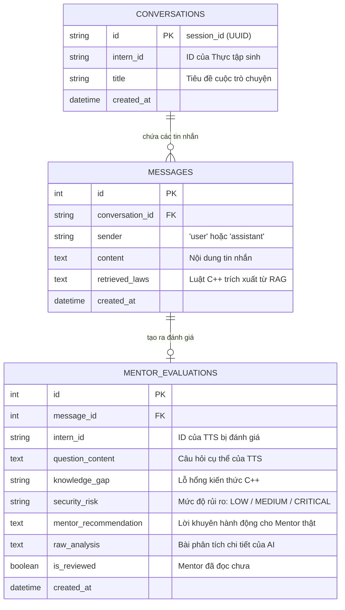

# TÀI LIỆU REVIEW THIẾT KẾ VÀ NÂNG CẤP HỆ THỐNG BACKEND
**Dự án:** C++ Intern Mentorship & AI Evaluation Backend  
**Kiến trúc:** FastAPI + SQLAlchemy (SQLite / MySQL) + ChromaDB (RAG) + Ollama (StrictMentor)  
**Ngày hoàn thiện:** 03/11/2026  

---

## 1. TỔNG QUAN CÁC FILE ĐÃ NÂNG CẤP VÀ TẠO MỚI

Theo đúng kế hoạch review trước đó, hệ thống đã được tách thành các module chuẩn mực:

1. 📄 [database.py](file:///E:/Mini%20Hackathon%202026/database.py): Cấu hình SQLAlchemy Engine (`sqlite:///./chat_system.db`), SessionLocal và Dependency `get_db`.
2. 📄 [models.py](file:///E:/Mini%20Hackathon%202026/models.py): Định nghĩa 3 bảng dữ liệu quan hệ (`Conversation`, `Message`, `MentorEvaluation`).
3. 📄 [main.py](file:///E:/Mini%20Hackathon%202026/main.py): Nâng cấp toàn diện API Backend tích hợp bộ nhớ hội thoại, RAG C++17, luồng đánh giá ngầm AI cho Mentor và các API Dashboard.
4. 📄 [test_upgrade.py](file:///E:/Mini%20Hackathon%202026/test_upgrade.py): Kịch bản kiểm thử tự động toàn bộ luồng.

---

## 2. CƠ SỞ DỮ LIỆU SQLALCHEMY (models.py)

---

## 3. CÁC API ENDPOINTS HOÀN THIỆN

### 3.1. Dành cho Thực tập sinh
* **`POST /chat`**:
  * Body: `{"intern_id": "intern_an", "session_id": "...", "message": "..."}`
  * Tự động lấy 4 tin nhắn gần nhất làm bộ nhớ hội thoại.
  * RAG tìm kiếm điều luật C++ liên quan từ [data/cpp_rule.md](file:///E:/Mini%20Hackathon%202026/data/cpp_rule.md).
  * Trả lời TTS theo phong cách Tech Lead gợi mở, không đưa code sẵn.
  * Tự động kích hoạt luồng đánh giá ngầm cho Mentor bằng `BackgroundTasks`.

* **`GET /history/{session_id}`**:
  * Tải lại toàn bộ lịch sử hỏi - đáp của một phiên chat.

### 3.2. Dành cho Mentor / Tech Lead
* **`GET /mentor/dashboard`**:
  * Trả về thống kê: Tổng câu hỏi, số rủi ro CRITICAL / MEDIUM / LOW.
  * Danh sách các đánh giá năng lực mới nhất của AI.
* **`GET /mentor/evaluations/{intern_id}`**:
  * Xem toàn bộ lịch sử đánh giá của một bạn TTS cụ thể.
* **`PATCH /mentor/evaluations/{eval_id}/read`**:
  * Đánh dấu Mentor đã xem xét trường hợp này.
