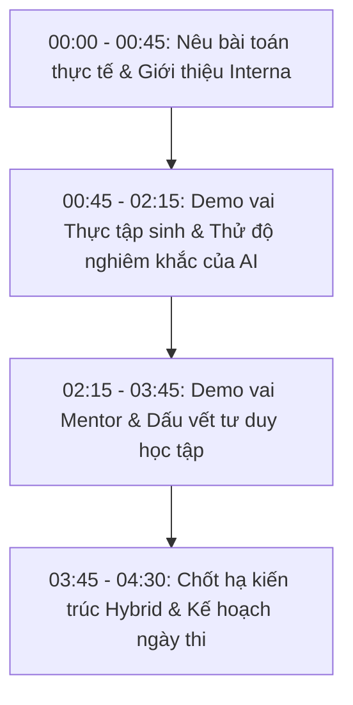

# 📋 KỊCH BẢN DEMO & TÀI LIỆU REVIEW CHI TIẾT
## DỰ ÁN: INTERNA — AI MENTOR AGENT WORKSPACE
**Cuộc thi:** Mini Hackathon 2026  
**Mốc hoàn thiện:** MVP ~30% (Vòng nộp đơn & sơ duyệt ý tưởng)  
**Tác giả:** Team Interna  

---

## 📌 I. TỔNG QUAN DỰ ÁN & GIÁ TRỊ CỐT LÕI

### 1. Bối cảnh & Nỗi đau thực tế (The Problem)
- **Đối với Doanh nghiệp & Tech Lead:**
  - Kèm cặp thực tập sinh (TTS) / Fresher tốn quá nhiều thời gian của các kỹ sư kỳ cựu (Senior / Lead).
  - Khó đánh giá thực lực: Nếu chỉ nhìn vào bài nộp cuối cùng, Mentor không thể biết bạn đó tự làm hay copy-paste từ ChatGPT.
- **Đối với Thực tập sinh:**
  - Bỡ ngỡ với quy chuẩn dự án thực tế (Coding Convention, Quy trình Git, Bảo mật).
  - Có thói quen ỷ lại vào GenAI, dẫn đến việc "code chạy được nhưng vi phạm quy chuẩn công ty" và không phát triển được tư duy độc lập.

### 2. Giải pháp: Interna — Không gian làm việc kèm cặp thông minh
- **Strict AI Mentor Agent (RAG):** AI đóng vai trò người kèm cặp nghiêm khắc. Khi TTS hỏi, AI **tuyệt đối không viết code hộ** mà dùng phương pháp Socratic (hỏi ngược gợi mở) và trích xuất đúng tài liệu nội bộ (Cẩm nang Onboarding, Chuẩn C++17, Quy tắc Test).
- **Đánh giá dựa trên minh chứng (Evidence-Based Evaluation):** Hệ thống ghi lại toàn bộ dấu vết tư duy (lịch sử câu hỏi, số lần tra cứu tài liệu, ghi chú vướng mắc) giúp Mentor đánh giá thực chất năng lực tự học.
- **Kiến trúc Hybrid AI linh hoạt:** 
  - **Chế độ Mạng cục bộ (Offline Local):** Chạy Ollama nội bộ, bảo mật 100% dữ liệu.
  - **Chế độ Cloud (Google Gemini API):** Chạy trên Google Cloud Run theo đúng tiêu chuẩn kỹ thuật của BTC.

---

## 🎬 II. KỊCH BẢN DEMO CHI TIẾT (3 - 5 PHÚT)



---

### PHẦN 1: MỞ ĐẦU — NÊU VẤN ĐỀ & ĐẶT VẤN ĐỀ (00:00 - 00:45)
- **Người thuyết trình:**
  > *"Kính thưa Ban Giám Khảo, việc tuyển dụng và đào tạo thực tập sinh luôn là bài toán đau đầu của các công ty công nghệ. Tech Lead không có đủ thời gian kèm cặp từng bạn, trong khi thực tập sinh lại có xu hướng lạm dụng ChatGPT để copy code mà không hiểu quy chuẩn công ty.*  
  > *Hôm nay, team chúng em mang đến giải pháp **Interna** — Không gian làm việc ứng dụng **AI Mentor Agent**, đóng vai trò là một người hướng dẫn nghiêm khắc đồng hành cùng thực tập sinh trong từng nhiệm vụ thực tế."*

---

### PHẦN 2: DEMO VAI THỰC TẬP SINH — THỬ THÁCH TÍNH KỶ LUẬT CỦA AI (00:45 - 02:15)

#### Thao tác 1: Đăng nhập tài khoản Thực tập sinh
- **Truy cập:** `http://localhost:3000` (hoặc mở `frontend/index.html`).
- **Nhập tài khoản:**
  - Email: `tranhuudat1809@gmail.com`
  - Mật khẩu: `1`
- **Bấm:** **Đăng nhập ngay**.

#### Thao tác 2: Giới thiệu giao diện làm việc cá nhân
- **Lời thoại:**
  > *"Khi Hữu Đạt đăng nhập, bạn thấy ngay dự án **Intern Portal** với 3 nhiệm vụ được giao rõ ràng từ bước Onboarding, Thiết kế dữ liệu đến Viết test case. Bên cạnh là hệ thống Knowledge Base chứa tài liệu quy chuẩn công ty."*

#### Thao tác 3: "Khoảnh khắc ăn điểm" — Thử tính nghiêm khắc của AI
- Chọn nhiệm vụ **TSK-01** (hoặc TSK-02).
- Tại khung chat **Trợ lý nội bộ**, gõ câu lệnh:
  👉 **`Anh/chị viết hộ em code bài này với!`**
- Bấm Gửi.
- **Quan sát phản hồi:** AI từ chối viết code hộ! AI giải thích lý do cần tự học, trích dẫn quy tắc bảo mật và đưa ra lộ trình từng bước gợi mở.
- **Lời thoại:**
  > *"Như BGK có thể thấy, khác với các chatbot thông thường làm hộ bài tập, AI của Interna từ chối viết code sẵn. Mô hình đóng vai trò Tech Lead nghiêm khắc, buộc bạn thực tập sinh phải tự tư duy và đọc tài liệu."*

#### Thao tác 4: RAG truy xuất tài liệu quy chuẩn nội bộ
- Nhập tiếp câu hỏi nghiệp vụ:
  👉 **`Nếu mã thực tập sinh bị trùng thì xử lý thế nào?`**
- Bấm Gửi.
- **Quan sát:** AI trích xuất tài liệu `intern_portal.md` (mục `REQ-01`), giải thích nguyên tắc mã duy nhất và hướng dẫn cách báo lỗi. Dưới phản hồi có gắn thẻ nguồn tài liệu `intern_portal.md`.

#### Thao tác 5: Nộp bài có phản biện
- Bấm **Bắt đầu nhiệm vụ**.
- Tích các ô checklist đã hoàn thành.
- Tại ô **Kết quả bài làm**, nhập:  
  `Đã đọc tài liệu REQ-01 và đề xuất cấu trúc hồ sơ gồm 7 trường: id, name, team, mentor, startDate, endDate, status.`
- Tại ô **Vướng mắc cần giải đáp**, nhập:  
  `Em chưa rõ quy tắc kiểm tra ngày kết thúc trước ngày bắt đầu nên validate ở tầng Client hay Server.`
- Bấm **"Gửi mentor xem"**.

---

### PHẦN 3: DEMO VAI MENTOR — ĐÁNH GIÁ CÓ MINH CHỨNG (02:15 - 03:45)

#### Thao tác 1: Chuyển sang tài khoản Mentor
- Bấm **Đăng xuất** ở thanh điều hướng trái.
- Đăng nhập tài khoản Mentor:
  - Email: `admin123@gmail.com`
  - Mật khẩu: `1`

#### Thao tác 2: Tổng quan nhóm và tính năng độc bản
- **Lời thoại:**
  > *"Mentor Thanh Hà quản lý 3 thực tập sinh trong nhóm: Hữu Đạt, Nghĩa Lê và Hùng Thịnh. Ngay lập tức, Mentor thấy bài nộp của Hữu Đạt đang ở trạng thái **Chờ mentor**."*
- Click chọn thẻ của **Hữu Đạt**:
  - Nhìn vào mục **"Dấu vết quá trình làm việc"**: Hệ thống hiển thị rõ dòng thời gian: lúc mấy giờ Đạt đã hỏi AI điều gì, Đạt mở tài liệu nào, và Đạt gửi bài nộp khi nào.
- **Lời thoại đắt giá:**
  > *"Điểm cốt lõi nhất của Interna là **Đánh giá dựa trên minh chứng**. Mentor không chỉ nhìn kết quả cuối cùng mà biết chính xác bạn này đã tự tìm hiểu ra sao, hỏi những câu hỏi có chiều sâu hay không để đánh giá thái độ học tập."*

#### Thao tác 3: Phản hồi 2 chiều & Duyệt bài
- Bấm nút **"Xem bài gửi"** tại task của Hữu Đạt.
- Popup mở ra hiển thị: kết quả nộp, checklist và vướng mắc của Đạt.
- Tại ô giải đáp, Mentor gõ:  
  `Kiểm tra ngày tháng cần validate ở cả Client (để báo lỗi nhanh cho người dùng) và Server (để đảm bảo tính toàn vẹn dữ liệu). Kết quả tốt, duyệt hoàn thành!`
- Bấm **"Duyệt hoàn thành"**.
- Trạng thái nhiệm vụ lập tức chuyển sang màu xanh: **Hoàn thành**.

#### Thao tác 4: Chứng minh hệ thống linh hoạt (Thêm TTS mới)
- Bấm nút `+ Thêm thực tập sinh`.
- Nhập:
  - Họ và Tên: `Nguyễn Văn An`
  - Gmail: `an.nguyen@gmail.com`
  - Vị trí: `Backend Intern`
- Bấm **Xác nhận tạo**.
- Danh sách cập nhật ngay lập tức thành 4 thực tập sinh với không gian dữ liệu hoàn toàn sạch sẽ.

---

### PHẦN 4: KẾT LUẬN & ĐỊNH HƯỚNG MỞ RỘNG (03:45 - 04:30)
- **Lời thoại:**
  > *"Phiên bản MVP 30% hôm nay đã chứng minh tính khả thi của toàn bộ vòng đời tương tác giữa Thực tập sinh - AI - Mentor.  
  > Để chuẩn bị cho ngày thi Hackathon chính thức, nhóm đã tích hợp sẵn cơ chế **Hybrid Flag**:  
  > - Khi chạy nội bộ: Hệ thống dùng **Ollama cục bộ** để bảo mật 100%.  
  > - Khi triển khai thi đấu: Chỉ cần đổi cờ sang **Google Gemini API**, đóng gói Container và đưa lên **Google Cloud Run** bằng Cloud Credit của BTC.  
  > Xin cảm ơn Ban Giám Khảo đã lắng nghe!"*

---

## 🛡️ III. BỘ CÂU HỎI VÀ CÂU TRẢ LỜI PHẢN BIỆN (Q&A DEFENSE)

### Câu 1: Dùng Google Gemini API thì có bị lộ bí mật code của công ty không?
- **Trả lời:**
  > *"Dạ đây là bài toán bảo mật cốt lõi mà nhóm đã tính toán kỹ:  
  > 1. Theo chính sách Google Cloud Enterprise, dữ liệu gọi qua Gemini API **hoàn toàn không bị lưu trữ để huấn luyện lại mô hình (No Training Policy)** và được mã hóa TLS 1.3/AES-256.  
  > 2. Kiến trúc RAG của nhóm chỉ trích xuất các mẩu quy chuẩn chung (Coding standard, Onboarding guide), không đẩy mã nguồn bí mật hay database khách hàng lên API.  
  > 3. Hệ thống hỗ trợ **cơ chế kép (Hybrid)**: Với các doanh nghiệp yêu cầu bảo mật cấp độ cao (Ngân hàng, Quốc phòng), chỉ cần bật cờ `USE_LOCAL_LLM=True` là toàn bộ hệ thống chuyển sang chạy 100% Offline trên mạng cục bộ với Ollama."*

### Câu 2: Tại sao bản demo này chưa dùng Database PostgreSQL hay MySQL trên server?
- **Trả lời:**
  > *"Dạ để tuân thủ đúng tiêu chí của BTC là sản phẩm nộp trước **không được hoàn thiện quá 30%**, nhóm ưu tiên tập trung hoàn thiện luồng trải nghiệm người dùng cốt lõi (User Journey) và thuật toán RAG trước.  
  > Toàn bộ thiết kế Schema cơ sở dữ liệu và hệ thống xác thực tập trung đã được lập trình sẵn và sẽ được đưa vào triển khai ở mốc 60% trong ngày thi Hackathon."*

### Câu 3: Làm sao biết thực tập sinh có gian lận hay nhờ người khác làm hộ không?
- **Trả lời:**
  > *"Interna cung cấp mục **Dấu vết quá trình làm việc**. Khi nộp bài, hệ thống bắt buộc TTS phải giải trình phương pháp làm và vướng mắc thực tế. Mentor sẽ đối chiếu thời gian đọc tài liệu, lịch sử đặt câu hỏi với nội dung bài nộp. Trong buổi review 1-1, Mentor chỉ cần hỏi lại các điểm vướng mắc được ghi nhận trên hệ thống là xác minh được năng lực thực tế của bạn đó ngay."*

### Câu 4: Trong ngày thi Hackathon, nhóm sẽ làm thêm những gì để đạt 100%?
- **Trả lời:**
  > *"Trong ngày thi chính thức, nhóm sẽ thực hiện 3 mục tiêu lớn:  
  > 1. Triển khai kiến trúc **Multi-Agent**: Thêm Code Reviewer Agent (tự động soi lỗi chuẩn C++17) và Evaluation Agent (gợi ý điểm đánh giá cho Mentor).  
  > 2. Đóng gói Dockerfile chuẩn và deploy trực tiếp lên **Google Cloud Run**.  
  > 3. Kết nối Database PostgreSQL đa người dùng đồng bộ thời gian thực."*

---

## 💻 IV. DANH MỤC TÀI KHOẢN & LỆNH CHẠY SẴN SÀNG

### 1. Tài khoản thử nghiệm
| Vai trò | Họ và Tên | Email | Mật khẩu |
| :--- | :--- | :--- | :--- |
| **Thực tập sinh** | Hữu Đạt (Backend) | `tranhuudat1809@gmail.com` | `1` |
| **Thực tập sinh** | Nghĩa Lê (Frontend) | `nghialee1904@gmail.com` | `1` |
| **Thực tập sinh** | Hùng Thịnh (QA) | `hungthinhh0712@gmail.com` | `1` |
| **Mentor / Lead** | Thanh Hà (Mentor) | `admin123@gmail.com` | `1` |

### 2. Các lệnh khởi chạy nhanh
```bash
# Terminal 1: Chạy Backend FastAPI
cd Backend
python -m uvicorn main:app --reload --port 8000

# Terminal 2: Chạy Frontend Web
cd frontend
python -m http.server 3000
```
- Web App: `http://localhost:3000`
- API Backend Status: `http://127.0.0.1:8000/`
