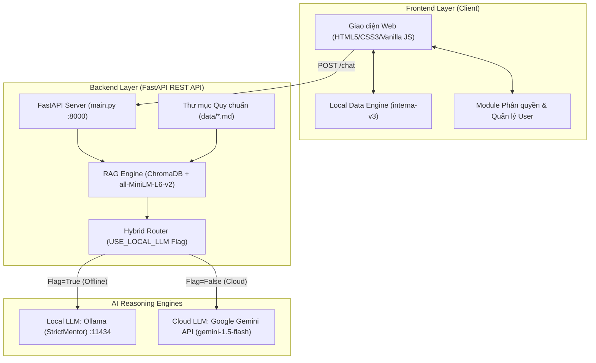
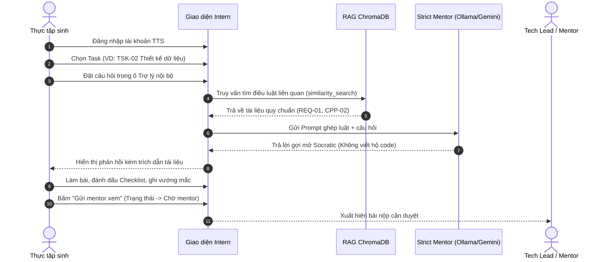
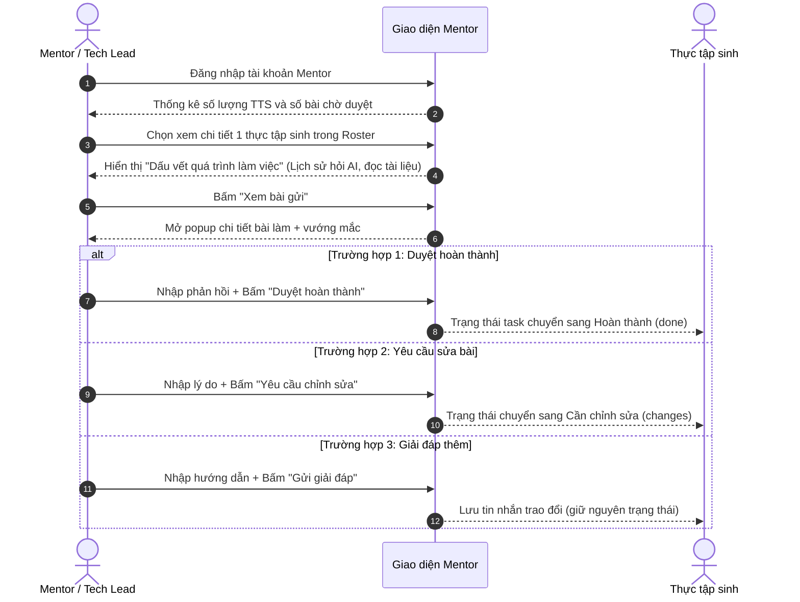

# 🏛️ INTERNA — TÀI LIỆU TOÀN DIỆN HỆ THỐNG & LỘ TRÌNH PHÁT TRIỂN
**Dự án:** Interna — Nền tảng Đào tạo và Kèm cặp Thực tập sinh Công nghệ ứng dụng AI Agents  
**Cuộc thi:** Mini Hackathon 2026  
**Trạng thái hiện tại:** MVP ~30% (Hoàn thiện vòng sơ duyệt)  
**Mục tiêu cuối cùng:** Sản phẩm 100% (Vòng Chung kết Hackathon)  

---

## 📑 MỤC LỤC
1. [Tổng quan dự án & Sứ mệnh](#1-tổng-quan-dự-án--sứ-mệnh)
2. [Kiến trúc hệ thống hiện tại (MVP 30%)](#2-kiến-trúc-hệ-thống-hiện-tại-mvp-30)
3. [Tất cả các luồng hoạt động chi tiết (Current User Flows)](#3-tất-cả-các-luồng-hoạt-động-chi-tiết-current-user-flows)
   - 3.1. [Luồng Xác thực & Phân quyền (Auth Flow)](#31-luồng-xác-thực--phân-quyền-auth-flow)
   - 3.2. [Luồng Thực tập sinh (Intern Workflow)](#32-luồng-thực-tập-sinh-intern-workflow)
   - 3.3. [Luồng Mentor theo dõi & Đánh giá (Mentor Workflow)](#33-luồng-mentor-theo-dõi--đánh-giá-mentor-workflow)
   - 3.4. [Luồng Hybrid AI Engine (Offline Ollama <-> Cloud Gemini)](#34-luồng-hybrid-ai-engine-offline-ollama---cloud-gemini)
4. [Bảng đối soát chức năng hiện tại (Feature Matrix 30%)](#4-bảng-đối-soát-chức-năng-hiện-tại-feature-matrix-30)
5. [Kế hoạch chi tiết để hoàn thành 100% dự án (Master Roadmap)](#5-kế-hoạch-chi-tiết-để-hoàn-thành-100-dự-án-master-roadmap)
   - 5.1. [Mốc 60%: Cơ sở hạ tầng Cloud & Database tập trung](#51-mốc-60-cơ-sở-hạ-tầng-cloud--database-tập-trung)
   - 5.2. [Mốc 100%: Hệ sinh thái Multi-Agent & Báo cáo nhân sự](#52-mốc-100-hệ-sinh-thái-multi-agent--báo-cáo-nhân-sự)
6. [Kế hoạch phân công nhiệm vụ cho nhóm (Team Workplan)](#6-kế-hoạch-phân-công-nhiệm-vụ-cho-nhóm-team-workplan)

---

## 1. TỔNG QUAN DỰ ÁN & SỨ MỆNH

### 1.1. Tuyên ngôn sản phẩm
**Interna** là không gian làm việc số tích hợp **AI Mentor Agent**, đóng vai trò là "Cầu nối văn hóa và kỹ thuật" giữa Nhà trường và Doanh nghiệp công nghệ. Sản phẩm giải quyết hai vấn đề nhức nhối:
1. **Thực tập sinh (TTS):** Thiếu người kèm cặp chi tiết, lạm dụng ChatGPT để copy code mù quáng mà không hiểu quy chuẩn công ty.
2. **Tech Lead / Senior:** Quá tải thời gian giải đáp các câu hỏi cơ bản, không có căn cứ đánh giá xem TTS thực sự tự học hay nhờ AI làm hộ.

### 1.2. Triết lý thiết kế (Design Philosophy)
- **Phương pháp Socratic (Strict Mentor):** AI **tuyệt đối không viết code sẵn**, chỉ đặt câu hỏi gợi mở, buộc thực tập sinh phải tự đọc tài liệu và tư duy giải pháp.
- **Đánh giá dựa trên minh chứng (Evidence-Based):** Mọi hành động (hỏi AI, mở tài liệu, nộp bài, nêu khó khăn) đều được ghi nhận làm căn cứ khách quan cho Mentor.
- **Bảo mật linh hoạt (Hybrid Security):** Tùy chọn chạy 100% Offline trên mạng cục bộ doanh nghiệp hoặc chạy Cloud trên Google Cloud Run.

---

## 2. KIẾN TRÚC HỆ THỐNG HIỆN TẠI (MVP 30%)



---

## 3. TẤT CẢ CÁC LUỒNG HOẠT ĐỘNG CHI TIẾT (CURRENT USER FLOWS)

### 3.1. Luồng Xác thực & Phân quyền (Auth Flow)
- **Màn hình đăng nhập sạch:** Không lưu tài khoản mẫu công khai, nhập Email + Mật khẩu.
- **Danh sách tài khoản hệ thống:**
  - `tranhuudat1809@gmail.com` (Pass: `1`) ➔ Thực tập sinh Backend.
  - `nghialee1904@gmail.com` (Pass: `1`) ➔ Thực tập sinh Frontend.
  - `hungthinhh0712@gmail.com` (Pass: `1`) ➔ Thực tập sinh QA.
  - `admin123@gmail.com` (Pass: `1`) ➔ Mentor / Tech Lead.
- **Phân lập dữ liệu hoàn toàn (`state.studentData[userId]`):** Mỗi thực tập sinh có không gian độc lập gồm chat, bài tập, checklist, bản nháp, nhật ký hoạt động. Chuyển đổi giữa các tài khoản không bị lẫn lộn dữ liệu.
- **Quyền chuyển đổi vai trò (Role Switch):** Chỉ tài khoản Mentor mới có nút chuyển qua lại giữa màn hình Mentor và Thực tập sinh để kiểm tra trải nghiệm.

---

### 3.2. Luồng Thực tập sinh (Intern Workflow)



- **Bước 1 — Nhận việc:** Xem danh sách 3 nhiệm vụ (`TSK-01`, `TSK-02`, `TSK-03`), hạn nộp, mô tả và checklist tiêu chí nghiệm thu.
- **Bước 2 — Tra cứu tài liệu:** Truy cập Knowledge Base đọc cẩm nang công ty (`onboarding.md`, `intern_portal.md`, `cpp_rule.md`, `testing_guide.md`).
- **Bước 3 — Tương tác với Strict Mentor:**
  - Nếu yêu cầu: *"Viết code hộ em"* ➔ AI từ chối, nêu rõ quy định và đặt câu hỏi gợi ý.
  - Nếu hỏi nghiệp vụ: AI trích xuất đúng điều luật từ vector database và dẫn link tài liệu.
- **Bước 4 — Nộp bài:** Nhập kết quả bài làm + vướng mắc thực tế ➔ Bấm **Gửi mentor xem**. Trạng thái task chuyển thành `review` (Chờ mentor).
- **Bước 5 — Nhận phản hồi & Sửa bài:** Xem trao đổi từ Mentor; nếu Mentor yêu cầu sửa bài (`changes`), TTS sửa và nộp lại phiên bản mới (lưu lịch sử version).

---

### 3.3. Luồng Mentor theo dõi & Đánh giá (Mentor Workflow)



- **Tổng quan nhóm:** Thấy toàn bộ danh sách thực tập sinh (`Họ tên`, `Gmail`, `Vị trí thực tập`), số lượng nhiệm vụ đã xong và số bài chờ xem.
- **Xem dấu vết tư duy học tập:** Xem dòng thời gian thực tế: TTS đã hỏi AI bao nhiêu câu, từng vướng mắc điều gì, mở tài liệu lúc mấy giờ.
- **Quyết định đánh giá 3 chiều:**
  - *Gửi giải đáp:* Trả lời vướng mắc mà không đổi trạng thái.
  - *Yêu cầu chỉnh sửa:* Trả lại bài bắt sửa, tự động lưu lịch sử lần nộp trước.
  - *Duyệt hoàn thành:* Xác nhận kết quả đạt yêu cầu.
- **Thêm thực tập sinh mới động:** Bấm `+ Thêm thực tập sinh`, nhập Họ tên, Gmail, Vị trí ➔ Hệ sinh thái tự động cấp không gian làm việc sạch 100% cho bạn mới.

---

### 3.4. Luồng Hybrid AI Engine (Offline Ollama <-> Cloud Gemini)

Trong file `Backend/.env`:
```ini
USE_LOCAL_LLM=True   # BẬT cờ: Chạy mạng cục bộ Ollama (Bảo mật 100%, không cần internet)
USE_LOCAL_LLM=False  # TẮT cờ: Chạy Google Gemini API (Theo yêu cầu BTC)
GEMINI_API_KEY=AIzaSy...
```
- **Khi `USE_LOCAL_LLM=True`:** Backend chuyển hướng request sang Ollama (`http://localhost:11434/api/generate`) với model `StrictMentor`.
- **Khi `USE_LOCAL_LLM=False`:** Backend chuyển hướng sang gọi `Google Gemini 1.5 Flash` qua API Key.
- **Fallback tự động:** Nếu tắt cờ nhưng chưa kịp điền API Key, hệ thống tự động fallback về Ollama và log cảnh báo, không làm sập server.

---

## 4. BẢNG ĐỐI SOÁT CHỨC NĂNG HIỆN TẠI (FEATURE MATRIX 30%)

| Nhóm chức năng | Tên tính năng | Mức độ hoàn thiện | Mô tả hiện trạng |
| :--- | :--- | :---: | :--- |
| **Xác thực** | Đăng nhập tài khoản | 100% (30% Scope) | Form đăng nhập email/mật khẩu, phân quyền Intern/Mentor. |
| **Xác thực** | Quản lý đa người dùng | 100% (30% Scope) | Dữ liệu cô lập độc lập per-user, Mentor thêm được TTS mới. |
| **Nhiệm vụ** | Quản lý vòng đời task | 100% (30% Scope) | Đầy đủ 5 trạng thái: `todo`, `active`, `review`, `changes`, `done`. |
| **Nhiệm vụ** | Nộp bài & Versioning | 100% (30% Scope) | Lưu lịch sử các lần nộp bài, ghi chú kết quả và vướng mắc. |
| **Knowledge** | Tra cứu tài liệu nội bộ | 100% (30% Scope) | Knowledge base popup hiển thị tài liệu markdown quy chuẩn. |
| **AI Agent** | Strict Mentor Socratic | 100% (30% Scope) | Từ chối làm hộ, kích thích tự học, trích dẫn quy tắc công ty. |
| **RAG** | Vector hóa & Truy xuất | 100% (30% Scope) | Dùng ChromaDB (`all-MiniLM-L6-v2`) trích xuất luật theo câu hỏi. |
| **Hạ tầng** | Cờ chuyển đổi Hybrid | 100% (30% Scope) | Cờ `USE_LOCAL_LLM` chuyển giữa Ollama offline và Google Gemini. |
| **Mentor** | Dấu vết làm việc | 100% (30% Scope) | Timeline ghi lại toàn bộ hoạt động của TTS phục vụ đánh giá. |
| **Database** | Lưu trữ dữ liệu | Client-side (Local) | Lưu trên `localStorage` (Chờ nâng cấp PostgreSQL ở mốc 60%). |
| **Cloud** | Triển khai Google Cloud | Chờ triển khai | Chuẩn bị Dockerfile đưa lên Google Cloud Run ở mốc 60%. |

---

## 5. KẾ HOẠCH CHI TIẾT ĐỂ HOÀN THÀNH 100% DỰ ÁN (MASTER ROADMAP)

Để đưa dự án từ **30% (hiện tại)** lên **100% (sản phẩm đoạt giải Hackathon)**, kế hoạch phát triển được chia làm 2 giai đoạn chính trong ngày thi:

```mermaid
gantt
    title Lộ trình phát triển hoàn thiện 100% Interna
    dateFormat  HH:mm
    axisFormat %H:%M
    section Mốc 30% (Đã xong)
    MVP Core & Hybrid RAG         :done,    00:00, 04:00
    section Mốc 60% (Ngày thi)
    Database PostgreSQL & Docker  :active,  04:00, 08:00
    Deploy Google Cloud Run       :         08:00, 10:00
    section Mốc 100% (Chung kết)
    Multi-Agent Code Reviewer     :         10:00, 14:00
    Security Gatekeeper Agent     :         14:00, 16:00
    Evaluation Radar & Export PDF :         16:00, 18:00
```



---

### 5.1. Mốc 60%: Cơ sở hạ tầng Cloud & Database tập trung
*Mục tiêu: Đưa ứng dụng lên online công khai trên Google Cloud Run và có cơ sở dữ liệu đồng bộ giữa các máy tính khác nhau.*

1. **Chuyển đổi lưu trữ sang PostgreSQL (SQLAlchemy):**
   - Thay thế `localStorage` bằng PostgreSQL (hoặc Cloud SQL của Google Cloud).
   - Thiết kế 4 bảng dữ liệu:
     - `Users`: `id`, `email`, `password_hash`, `name`, `role`, `team`.
     - `Tasks`: `id`, `student_id`, `status`, `checklist_state`.
     - `Submissions`: `id`, `task_id`, `version`, `result`, `blocker`, `submitted_at`.
     - `ChatLogs`: `id`, `user_id`, `task_id`, `role`, `content`, `docs`, `created_at`.
2. **Bộ nhớ hội thoại thông minh (Multi-turn Conversation Memory):**
   - Nạp 4 - 6 tin nhắn gần nhất kèm câu hỏi hiện tại để Gemini hiểu được ngữ cảnh hội thoại liên tục của thực tập sinh.
3. **Đóng gói Dockerfile & Triển khai Google Cloud Run:**
   - Viết `Dockerfile` đa tầng (Multi-stage build) kết hợp FastAPI phục vụ cả API và static frontend.
   - Chạy lệnh `gcloud run deploy interna --source .` nhận URL public dạng: `https://interna-xxx.a.run.app`.

---

### 5.2. Mốc 100%: Hệ sinh thái Multi-Agent & Báo cáo nhân sự
*Mục tiêu: Đạt điểm tối đa về tiêu chí sáng tạo, tính thực tế và chuyên sâu về AI Agents.*

1. **Multi-Agent 1: Automated C++ Code Reviewer Agent:**
   - **Đầu vào:** TTS dán đoạn mã C++ hoặc link GitHub commit.
   - **Nhiệm vụ:** Agent tự động phân tích tĩnh (Static Analysis) đối chiếu quy chuẩn `cpp_rule.md`:
     - Bắt lỗi quản lý bộ nhớ: cảnh báo `new/delete` thô, đề xuất `std::unique_ptr` hoặc `std::make_unique`.
     - Bắt lỗi đặt tên: hàm dùng snake_case thay vì camelCase.
     - Kiểm tra an toàn: thiếu kiểm tra con trỏ rỗng (`nullptr`), thiếu `#pragma once`.
   - **Đầu ra:** Bảng nhận xét trực quan với diff highlight code trước khi bài gửi tới Mentor.

2. **Multi-Agent 2: Security & Secret Gatekeeper Agent:**
   - Quét thời gian thực (Regex + LLM) mọi tin nhắn hoặc code gửi lên.
   - Nếu phát hiện API Key, chuỗi kết nối Database, mật khẩu plain-text ➔ Lập tức chặn gửi, che mờ `[REDACTED_SECRET]` và hiển thị bài học bảo mật.

3. **Multi-Agent 3: Evaluation & Rubric Grading Agent:**
   - Tự động phân tích toàn bộ lịch sử học tập của TTS và đề xuất bảng điểm 5 tiêu chí:
     1. *Mức độ độc lập (Independence):* Dựa trên số lần hỏi và mức độ phụ thuộc AI.
     2. *Tuân thủ quy chuẩn (Convention):* Tỉ lệ vi phạm quy tắc coding.
     3. *Tư duy giải quyết vấn đề (Problem Solving):* Khả năng tự gỡ lỗi sau gợi ý.
     4. *Tính chủ động (Proactivity):* Tốc độ bắt đầu và hoàn thành task.
     5. *Kỹ năng giao tiếp kỹ thuật (Communication):* Cách mô tả vướng mắc.
   - Vẽ **Biểu đồ mạng nhện (Radar Chart)** trực quan trên Dashboard của Mentor.

4. **Tính năng Xuất Portfolio Báo cáo Tuyển dụng (Export PDF):**
   - Cuối kỳ thực tập, hệ thống xuất ra file PDF tổng kết thành tích thực tập sinh.
   - Đưa ra đề xuất cho HR: *Tuyển thẳng lên Junior Developer / Cần thực tập bổ sung / Không đạt yêu cầu*.

---

## 6. KẾ HOẠCH PHÂN CÔNG NHIỆM VỤ CHO NHÓM (TEAM WORKPLAN)

Dành cho nhóm 2 - 3 thành viên trong ngày thi Hackathon:

| Thành viên | Trách nhiệm chính | Công việc cụ thể trong ngày thi |
| :--- | :--- | :--- |
| **Thành viên 1** (AI & Prompts Lead) | Phát triển hệ thống Multi-Agent & RAG | - Tối ưu Prompting cho Google Gemini 1.5 Flash.<br>- Xây dựng Code Reviewer Agent & Evaluation Agent.<br>- Tinh chỉnh Embedding chunking cho tài liệu công ty. |
| **Thành viên 2** (Backend & Cloud Lead) | Hạ tầng API & Triển khai Cloud | - Xây dựng cơ sở dữ liệu PostgreSQL qua SQLAlchemy.<br>- Viết Dockerfile và deploy lên Google Cloud Run.<br>- Thiết lập Secret Manager và các endpoint REST API mới. |
| **Thành viên 3** (Frontend & UX Lead) | Trải nghiệm giao diện & Trực quan hóa | - Xây dựng component Code Editor (Monaco/CodeMirror) soi lỗi code.<br>- Vẽ biểu đồ Radar Chart năng lực thực tập sinh.<br>- Chuẩn bị Slide thuyết trình và phối hợp chạy kịch bản Demo. |

---

## 📌 VII. TỔNG KẾT

Tài liệu này thể hiện toàn diện hiện trạng của dự án **Interna** ở mức độ **MVP ~30%** (chuẩn quy định sơ tuyển) và vạch ra lộ trình kỹ thuật chi tiết để đạt **100% trong ngày thi Hackathon**. 

Dự án có tính thực tiễn cao, giải quyết trúng nỗi đau đào tạo công nghệ, ứng dụng sâu sắc hệ sinh thái **Google Gemini API** & **Google Cloud Run**, sẵn sàng để chinh phục các giải thưởng cao nhất của cuộc thi!
