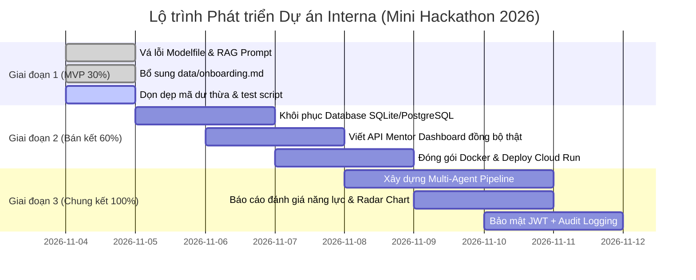

# 🚀 KẾ HOẠCH TOÀN DIỆN VÀ TIẾN TRÌNH CẢI THIỆN DỰ ÁN (INTERNA)
**Dự án:** Interna — Nền tảng Kèm cặp & Đánh giá Thực tập sinh Công nghệ ứng dụng AI Agents  
**Cuộc thi:** Mini Hackathon 2026  
**Mục tiêu tài liệu:** Ghi nhận toàn bộ kết quả rà soát hiện trạng, nhận diện khuyết điểm, dư thừa và thiết lập quy trình hành động từng bước đưa dự án từ **MVP 30%** lên **Hoàn thiện 100%**.

---

## Phạm vi thực thi được chốt — MVP 30% (04/11/2026)

Theo yêu cầu dự thi, chỉ triển khai giai đoạn 1 và cải thiện trải nghiệm của luồng demo. “30%” là mốc phạm vi chức năng của roadmap, không phải tỷ lệ dòng mã hoặc số checkbox hoàn tất. Các giai đoạn 2–3 bên dưới chỉ là định hướng, chưa triển khai.

Đã thực hiện:
- Backend nhận task context và bốn tin nhắn gần nhất; áp dụng hướng dẫn Socratic cho cả hai engine; không tạo nguồn trích dẫn giả khi không có kết quả.
- Bổ sung onboarding khớp tài liệu frontend; đường dẫn dữ liệu độc lập thư mục chạy; collection Chroma theo fingerprint tài liệu, tự nạp khi khởi động, không xóa collection cũ.
- Đổi model nền theo kế hoạch sang `qwen2.5:3b`; giữ chế độ API vốn đã bật.
- Lối vào demo theo vai trò, hướng dẫn ba bước, tăng cỡ chữ và vùng bấm, bố cục mobile, trạng thái chờ AI, hỗ trợ bàn phím và giảm chuyển động.
- Sửa bộ QA từ store cũ sang `interna-v3`, dữ liệu từng thực tập sinh và trạng thái nhiệm vụ thực tế. Khôi phục đúng vai trò mentor khi tải lại trang.

Chưa triển khai: database tập trung, API đồng bộ mentor, Docker/Cloud Run, streaming, multi-agent, đánh giá năng lực tự động, báo cáo PDF, JWT/RBAC và tái cấu trúc toàn bộ frontend. Mockup cũ giữ nguyên để không xóa tài sản tham khảo; giao diện chạy chính là `frontend/index.html`.

Kiểm tra: `node outputs/qa/check-demo.cjs`, `python3 Backend/test_prompt.py`, Python compile và `git diff --check` đạt. Chrome desktop 1440px và mobile 390px không có lỗi JavaScript hoặc tràn ngang; đã xem ảnh giao diện. Test prompt chạy offline; chưa xác nhận suy luận Ollama/Gemini thật hoặc tái lập chỉ mục với mô hình embedding trên máy này.

---

## 📑 MỤC LỤC
1. [Tổng quan hiện trạng & Kết quả rà soát (Audit Summary)](#1-tổng-quan-hiện-trạng--kết-quả-rà-soát)
2. [Chi tiết các khuyết điểm & Lỗ hổng kỹ thuật (Identified Flaws)](#2-chi-tiết-các-khuyết-điểm--lỗ-hổng-kỹ-thuật)
3. [Danh mục thành phần dư thừa & Nợ kỹ thuật (Technical Debt & Cleanup)](#3-danh-mục-thành-phần-dư-thừa--nợ-kỹ-thuật)
4. [Giải pháp kỹ thuật & Bản vá cụ thể (Technical Solutions & Patches)](#4-giải-pháp-kỹ-thuật--bản-vá-cụ-thể)
5. [Quy trình phát triển & Lộ trình 3 giai đoạn lên 100% (Master Roadmap)](#5-quy-trình-phát-triển--lộ-trình-3-giai-đoạn-lên-100)
6. [Bảng kiểm tra thực thi theo vai trò (Execution Checklist)](#6-bảng-kiểm-tra-thực-thi-theo-vai-trò)

---

## 1. TỔNG QUAN HIỆN TRẠNG & KẾT QUẢ RÀ SOÁT

Hệ thống hiện tại gồm 2 khối độc lập:
- **Frontend (`frontend/`):** Xây dựng bằng Vanilla HTML/CSS/JavaScript, mô phỏng toàn bộ hành trình trải nghiệm của Thực tập sinh và Tech Lead / Mentor.
- **Backend (`Backend/`):** Xây dựng bằng FastAPI, RAG ChromaDB và bộ chuyển đổi Hybrid (Ollama `StrictMentor` cục bộ hoặc Google Gemini Cloud).

```mermaid
flowchart LR
    subgraph Current["Hiện trạng (MVP 30%)"]
        direction TB
        F1["Frontend (app.js 1000+ dòng)"] -->|localStorage| S1["Dữ liệu lưu trình duyệt đơn lẻ"]
        F1 -->|POST /chat (chưa dùng context/history)| B1["Backend (main.py)"]
        B1 -->|ChromaDB thiếu onboarding.md| R1["RAG Engine"]
        B1 -->|Modelfile sai base model| O1["Ollama Local"]
    end

    subgraph Target["Mục tiêu Hoàn thiện (100%)"]
        direction TB
        F2["Frontend Modular (JS Modules / React)"] -->|REST / SSE Streaming| B2["FastAPI Server"]
        B2 <--> DB["PostgreSQL / SQLite Central Database"]
        B2 --> R2["RAG Vector DB (Full Docs)"]
        B2 --> MA["Multi-Agent (StrictMentor + CodeReview + TalentEvaluator)"]
        MA --> Cloud["Google Cloud Run (Hybrid Engine)"]
    end

    Current -.->|Quy trình nâng cấp| Target
```

---

## 2. CHI TIẾT CÁC KHUYẾT ĐIỂM & LỖ HỔNG KỸ THUẬT

### 2.1. Tầng Backend & RAG AI Engine
1. **Mất liên kết hội thoại nhiều lượt (`history` bị bỏ rơi):**
   - *Hiện tượng:* Frontend gửi kèm mảng `history: [{role, content}, ...]`, nhưng `ChatRequest` trong `Backend/main.py` không nhận trường này.
   - *Hậu quả:* AI hoàn toàn không có bộ nhớ (stateless). Khi người dùng hỏi nối tiếp (ví dụ: *"Thế còn trường hợp thứ 2 thì sao?"*), AI không hiểu ngữ cảnh câu trước.
2. **Bỏ quên ngữ cảnh nhiệm vụ (`task_context`):**
   - *Hiện tượng:* Frontend gửi `task_context` (tiêu đề, mô tả nhiệm vụ), nhưng `main.py` không chèn vào prompt gửi cho LLM.
   - *Hậu quả:* AI trả lời chung chung, không bám sát yêu cầu nghiệp vụ cụ thể của Task đang mở.
3. **Thiếu file tài liệu nguồn `onboarding.md`:**
   - *Hiện tượng:* Task `TSK-01` yêu cầu tra cứu cẩm nang onboarding, nhưng trong thư mục `Backend/data/` chỉ có 3 file (`cpp_rule.md`, `intern_portal.md`, `testing_guide.md`), hoàn toàn thiếu `onboarding.md`.
   - *Hậu quả:* RAG truy xuất thiếu chính xác, trích dẫn sai nguồn tài liệu.
4. **Lỗi định danh Model trong `Modelfile`:**
   - *Hiện tượng:* Dòng đầu tiên của `Backend/Modelfile` khai báo `FROM qwen3.5:4b`. Thư viện chính thức của Ollama không có tag này (chỉ có `qwen2.5:3b`, `qwen2.5:7b`,...).
   - *Hậu quả:* Lệnh `ollama create StrictMentor -f Modelfile` sẽ báo lỗi `Error: pull model manifest: file does not exist`.
5. **Thiếu cơ chế Streaming Response:**
   - *Hiện tượng:* Khi chạy LLM cục bộ trên máy Mac, thời gian sinh văn bản có thể mất từ 10–25 giây. Việc chờ response nguyên khối làm người dùng có cảm giác ứng dụng bị treo.

### 2.2. Tầng Frontend & Quản lý Trạng thái (State Management)
1. **Lưu trữ dữ liệu cô lập trên `localStorage`:**
   - Dữ liệu nhiệm vụ, bài nộp, vướng mắc và duyệt bài chỉ lưu trên trình duyệt của 1 máy (`interna-v3`). Không thể phân tách để Mentor mở trên laptop khác mà theo dõi được bài nộp của TTS.
2. **Cấu trúc mã nguồn monolithic (`app.js`):**
   - `frontend/app.js` dài hơn 1.040 dòng chứa toàn bộ logic Auth, State, Templates HTML, Markdown rendering, Mocking và Fetching. Gây khó khăn khi debug và xung đột khi nhiều người cùng commit.
3. **Bảo mật đăng nhập mô phỏng:**
   - Mật khẩu và thông tin tài khoản hardcode trong mảng `DEFAULT_USERS`, dễ bị lộ và can thiệp qua Developer Tools.

---

## 3. DANH MỤC THÀNH PHẦN DƯ THỪA & NỢ KỸ THUẬT

| STT | Tệp tin / Thành phần | Tình trạng | Giải pháp xử lý |
| :---: | :--- | :--- | :--- |
| **1** | `outputs/mockups/ai-mentor-demo.html` (92KB) | File HTML mockup ban đầu, không còn dùng đến. | Di chuyển vào thư mục `archive/` hoặc xóa để nhẹ repo. |
| **2** | `outputs/mockups/ai-mentor-preview.html` (11KB) | File HTML preview tĩnh sơ khai. | Di chuyển vào `archive/` hoặc xóa. |
| **3** | `Backend/REVIEW_CHANGES.md` | Chứa đường dẫn tuyệt đối Windows cá nhân (`file:///E:/...`) và mô tả file DB cũ đã xóa. | Cập nhật lại nội dung đúng với kiến trúc hiện tại hoặc xóa bỏ. |
| **4** | `outputs/qa/check-demo.cjs` | Dùng store cũ (`interna-demo-v1`) và user cũ (`linh`, `an`), chạy sẽ lỗi. | Cập nhật lại test script khớp với store `interna-v3` và user mới (`dat`, `nghia`, `thinh`). |
| **5** | `INTEGRATION_REVIEW.md` (dòng 12, 27) | Báo cáo cũ đề cập `database.py`, `models.py` và `GET /mentor/dashboard` (đã bị xóa ở commit 7de6ba5). | Hiệu chỉnh nội dung để phản ánh trung thực trạng thái 30%. |

---

## 4. GIẢI PHÁP KỸ THUẬT & BẢN VÁ CỤ THỂ

### 4.1. Nâng cấp `Backend/main.py` để hỗ trợ Context & History đầy đủ

```python
# Cấu trúc dữ liệu tiếp nhận từ Frontend
from pydantic import BaseModel
from typing import Optional, List, Dict, Any

class HistoryItem(BaseModel):
    role: str
    content: str

class TaskContext(BaseModel):
    title: Optional[str] = None
    description: Optional[str] = None
    document_ids: Optional[List[str]] = []

class ChatRequest(BaseModel):
    message: Optional[str] = None
    user_message: Optional[str] = None
    task_id: Optional[str] = None
    task_context: Optional[TaskContext] = None
    history: Optional[List[HistoryItem]] = []

# Cập nhật Prompt trong /chat endpoint
@app.post("/chat")
def chat_endpoint(req: ChatRequest):
    user_query = req.message or req.user_message
    if not user_query or not user_query.strip():
        raise HTTPException(status_code=400, detail="Tin nhắn không được để trống!")

    # 1. RAG Query
    docs = vector_db.similarity_search(user_query, k=2)
    retrieved_law = "\n\n".join([d.page_content for d in docs])
    sources = list(set([os.path.basename(d.metadata.get("source", "")) for d in docs if d.metadata.get("source")]))
    if not sources:
        sources = ["intern_portal.md"]

    # 2. Xây dựng ngữ cảnh Task & History
    task_str = ""
    if req.task_context and req.task_context.title:
        task_str = f"\n[NHIỆM VỤ ĐANG THỰC HIỆN: {req.task_context.title}]\n[MÔ TẢ: {req.task_context.description or ''}]\n"

    history_str = ""
    if req.history:
        # Lấy tối đa 4 tin nhắn gần nhất để giữ ngữ cảnh ngắn gọn
        recent = req.history[-4:]
        history_str = "\n[LỊCH SỬ TRAO ĐỔI TRƯỚC ĐÓ]:\n" + "\n".join([f"- {h.role}: {h.content}" for h in recent]) + "\n"

    prompt = (
        f"Dựa vào các điều khoản quy chuẩn nội bộ sau:\n{retrieved_law}\n"
        f"{task_str}"
        f"{history_str}\n"
        f"Câu hỏi của thực tập sinh: {user_query}\n\n"
        f"Hãy trả lời với vai trò StrictMentor: Không giải hộ bài tập, không viết code sẵn, hãy đặt câu hỏi gợi mở Socratic và chỉ dẫn tài liệu liên quan."
    )

    # 3. Phân nhánh Engine
    if is_local_mode():
        ai_reply = call_ollama(prompt)
    else:
        ai_reply = call_gemini(prompt)

    return {
        "reply": ai_reply,
        "docs": sources
    }
```

### 4.2. Bổ sung `Backend/data/onboarding.md`
Tạo file `Backend/data/onboarding.md` với nội dung chuẩn:
```markdown
# CẨM NANG HƯỚNG DẪN THỰC TẬP SINH (ONBOARDING GUIDE)

## ONB-01 · Quy trình Nhận và Làm nhiệm vụ
1. Thực tập sinh có trách nhiệm đọc kỹ tài liệu yêu cầu nghiệp vụ và tài liệu kỹ thuật trước khi bắt đầu.
2. Khi gặp khó khăn, chủ động đặt câu hỏi cho AI Mentor hoặc ghi rõ vào ô "Vướng mắc cần mentor giải đáp".
3. Tuyệt đối không copy mã nguồn hoàn chỉnh từ các công cụ bên ngoài mà không hiểu bản chất.

## ONB-02 · Tiêu chuẩn Sử dụng AI Trợ lý Nội bộ
- AI Mentor được lập trình theo phương pháp gợi mở (Socratic). AI sẽ không viết code hộ.
- Mọi câu hỏi và tần suất tra cứu tài liệu của bạn được hệ thống ghi nhận làm căn cứ đánh giá tinh thần tự học.

## ONB-03 · Trách nhiệm và Vai trò của Mentor
- Mentor xem xét kết quả nộp bài, giải đáp các vướng mắc có chiều sâu và phản hồi 2 chiều.
- Quyết định đánh giá hoàn thành nhiệm vụ thuộc về Mentor thật sự.
```

### 4.3. Hiệu chỉnh `Backend/Modelfile`
Thay dòng đầu tiên:
```dockerfile
FROM qwen2.5:3b
```
*(Nếu máy có RAM từ 16GB trở lên và chip Apple Silicon M1/M2/M3, có thể chọn `FROM qwen2.5:7b` để tư duy code sắc bén hơn).*

---

## 5. QUY TRÌNH PHÁT TRIỂN & LỘ TRÌNH 3 GIAI ĐOẠN LÊN 100%



### 🔹 GIAI ĐOẠN 1: TỐI ƯU VÀ KHẮC PHỤC TRIỆT ĐỂ BẢN 30% (Thực hiện ngay)
- **Mục tiêu:** Đảm bảo bản demo chạy thông suốt 100% không có lỗi ngầm khi Ban giám khảo kiểm tra trực tiếp.
- **Hạng mục công việc:**
  1. Cập nhật `Backend/Modelfile` trỏ về `qwen2.5:3b`.
  2. Bổ sung `Backend/data/onboarding.md` và tái lập chỉ mục ChromaDB.
  3. Cập nhật `Backend/main.py` nhận `history` và `task_context`.
  4. Bật cờ `mode: "api"` trong `frontend/config.js`.
  5. Xóa hoặc di chuyển các file rác trong `outputs/mockups/`.

---

### 🔹 GIAI ĐOẠN 2: ĐỒNG BỘ DỮ LIỆU TẬP TRUNG & CLOUD RUN 60% (Vòng Bán kết)
- **Mục tiêu:** Chuyển đổi từ ứng dụng đơn máy (`localStorage`) thành ứng dụng Client-Server thực thụ, nhiều máy kết nối cùng lúc.
- **Hạng mục công việc:**
  1. **Cơ sở dữ liệu tập trung (Database):**
     - Tạo lại `Backend/database.py` và `Backend/models.py` dùng SQLite (cho local) và PostgreSQL (cho Cloud).
     - Bảng `users`, `tasks`, `submissions`, `chat_history`, `mentor_reviews`.
  2. **API 2 chiều cho Mentor:**
     - `GET /api/mentor/submissions`: Lấy danh sách bài nộp của tất cả học viên.
     - `POST /api/mentor/review`: Gửi nhận xét và cập nhật trạng thái bài làm từ xa.
  3. **Đóng gói Docker:**
     - Viết `Backend/Dockerfile` (Python FastAPI + ChromaDB).
     - Viết `frontend/Dockerfile` (Nginx phục vụ static file).
     - Viết `docker-compose.yml` để khởi chạy toàn bộ hệ thống bằng 1 lệnh:
       ```bash
       docker-compose up --build
       ```
  4. **Triển khai Cloud:**
     - Đưa container Backend lên **Google Cloud Run** sử dụng Cloud Credit của ban tổ chức.

---

### 🔹 GIAI ĐOẠN 3: HỆ SINH THÁI MULTI-AGENT & ĐÁNH GIÁ THÔNG MINH 100% (Vòng Chung kết)
- **Mục tiêu:** Tạo ra sự khác biệt cạnh tranh vượt trội (Competitive Edge) so với các đội thi khác bằng kiến trúc Multi-Agent.
- **Hạng mục công việc:**
  1. **Bộ 3 AI Agents chuyên trách:**
     - **Strict Mentor Agent:** Chuyên trách hỏi đáp Socratic và tra cứu quy chuẩn.
     - **Code Review & Security Auditor Agent:** Quét mã nguồn thực tập sinh nộp để phát hiện:
       - Vi phạm C++17 (như dùng raw pointers `new/delete`).
       - Lỗ hổng bảo mật (Hardcoded credentials, SQL Injection, Buffer Overflow).
     - **Talent Evaluator Agent:** Phân tích dấu vết tư duy: số lần hỏi, nội dung vướng mắc, mức độ chủ động để đề xuất điểm số khách quan (A/B/C) cho Mentor.
  2. **Dashboard Báo cáo Trực quan:**
     - Biểu đồ mạng nhện (Radar Chart) đánh giá 5 khía cạnh: Tinh thần tự học, Kỹ năng giải quyết vấn đề, Tuân thủ quy chuẩn, Kiến thức nền tảng, Kỹ năng kiểm thử.
     - Tính năng xuất báo cáo đánh giá thực tập sinh dạng PDF.
  3. **Bảo mật chuẩn Enterprise:**
     - Đăng nhập bảo mật bằng JWT Access Token.
     - Role-Based Access Control (RBAC) nghiêm ngặt giữa Intern và Mentor.

---

## 6. BẢNG KIỂM TRA THỰC THI THEO VAI TRÒ (EXECUTION CHECKLIST)

### 👨‍💻 Kỹ sư Backend & AI
- [ ] Đổi base model trong `Modelfile` sang `qwen2.5:3b`.
- [ ] Thêm file `Backend/data/onboarding.md`.
- [ ] Cập nhật schema `ChatRequest` và RAG Prompt trong `Backend/main.py`.
- [ ] Kiểm thử `python3 test_mvp.py` với câu hỏi ngữ cảnh liên tiếp.
- [ ] Viết `Dockerfile` cho Backend sẵn sàng deploy Google Cloud Run.

### 🎨 Kỹ sư Frontend & UI/UX
- [ ] Đổi `mode: "api"` trong `frontend/config.js`.
- [ ] Thêm hiệu ứng gõ chữ (typing indicator / loading skeleton) trong khi chờ AI phản hồi.
- [ ] Hiển thị thông báo rõ ràng khi Backend chưa bật hoặc mất kết nối.
- [ ] Tách nhỏ `app.js` thành các module độc lập theo cấu trúc thư mục sạch.

### 📋 Đội trưởng & Thuyết trình viên (Lead & Presenter)
- [ ] Bám sát kịch bản tại [DEMO_SCRIPT.md](file:///Users/tranhuudat1809/Mini-Hackathon-2026/DEMO_SCRIPT.md).
- [ ] Luyện tập kịch bản phản biện Q&A bảo mật dữ liệu doanh nghiệp và kiến trúc Hybrid.
- [ ] Dọn dẹp các mockup thừa để tránh nhầm lẫn khi nộp repo cho Ban giám khảo.

---
*Tài liệu này được tạo tự động nhằm chuẩn hóa toàn bộ quy trình phát triển dự án Interna.*
